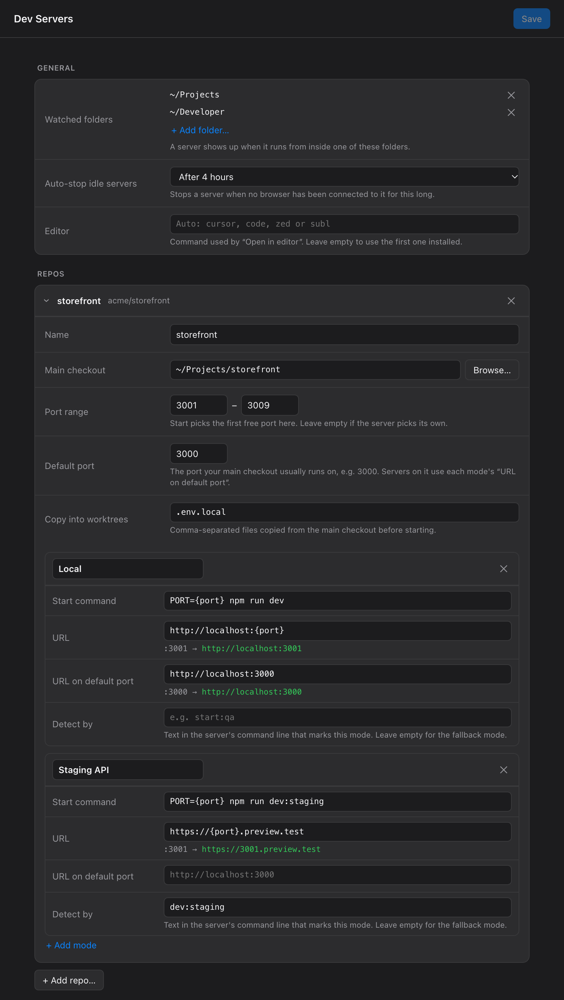

# Dev Servers

A SwiftBar plugin that shows the dev servers running on your Mac and lets you start, open, restart and stop them from the menu bar.

I built it because I kept losing track of my own servers. Three worktrees, a couple of side projects, an agent running tests in another branch, and suddenly I'm running `lsof -i :3004` to find out what's on that port and which branch it belongs to. Dev Servers answers that at a glance. It also starts a branch on the next free port for you, with the right URL, so you stop juggling ports by hand.



## What it does

Every running server shows up in the menu, grouped by repo and worktree. Each one gets a line with its port, branch, uptime, memory and CPU, and a coloured dot: green when it answers, orange while it's busy (usually compiling), red when it returns 5xx errors. Under it are Open and Stop, and Restart is in the server's submenu.

A server you start from the menu appears at once with a grey ring and "starting…", so you can see it's on its way (and stop it) before its port opens.

To start something, pick a worktree and a mode from the Start menu. Modes are whatever you need, for example "Local" and "Staging API", each with its own start command and URL. Dev Servers takes the first free port in the repo's range, copies files like `.env.local` over from your main checkout if the worktree doesn't have them, and sends a notification once the server is listening. Use **Open** in the menu when you want the page.

A few other things it handles:

- If a server you started from the menu dies or never comes up, you get a notification with the error from its log. A failed start, a server that crashes, or a start that still isn't listening after 4 minutes stays in the menu with a red dot and the error, the end of its log in the submenu, and Retry (or Stop, if it's still running) and Dismiss.
- It warns you when another app is holding a port in one of your ranges, or when a range has no free ports left.
- It can stop servers nobody has had open in a browser for a few hours. This is off unless you turn it on.
- Everything is set up in a settings window. You never need to edit the config file.

## Requirements

- macOS 13 or later
- [SwiftBar](https://swiftbar.app) 2.0 or later. The installer installs it if it's missing.
- `jq`, which ships with macOS 15 and later. On older versions, `brew install jq`.
- `python3` from Apple's command line tools (`xcode-select --install`). Only the settings window uses it.

If you have Google Chrome, Microsoft Edge or Brave, Settings opens in its own small window. Otherwise it opens as a tab in your default browser.

## Install

### With Homebrew

```bash
brew install --cask mohitsharma0101/tap/dev-servers
```

This installs SwiftBar too if you don't have it, and puts the plugin in `~/.swiftbar`. Homebrew can't start SwiftBar for you, so finish with:

```bash
~/.swiftbar/dev-servers.sh enable
```

That points SwiftBar at the plugin folder and starts it, and the icon appears in your menu bar. Update with `brew upgrade`, remove with `brew uninstall --cask dev-servers`, and add `--zap` to also remove settings, cache and logs.

- If you installed SwiftBar from its website, run `brew install --cask --adopt swiftbar` first so Homebrew takes it over.
- If you installed Dev Servers with the install script before, add `--adopt` to the install command.
- If SwiftBar already uses a plugin folder other than `~/.swiftbar`, use the install script instead. It finds your folder.

### With the install script

```bash
curl -fsSL https://github.com/MohitSharma0101/swiftbar-dev-servers/releases/latest/download/install.sh | bash
```

The installer checks for SwiftBar and installs it if it's missing: with Homebrew when you have it, otherwise from SwiftBar's own GitHub release, which it only installs if the app is signed by SwiftBar's developer. It never asks for an admin password. Then it downloads the plugin from the latest release here, checks it against the release's `SHA256SUMS`, copies it into your SwiftBar plugin folder (or sets up `~/.swiftbar` if you've never used SwiftBar) and refreshes SwiftBar.

To update, run the same command again. Your settings stay as they are. To install a specific release, end the command with `bash -s -- --version 1.0.0`.

### Check before you run it

If you'd rather read the installer first, download it, look through it, then run it:

```bash
curl -fsSLO https://github.com/MohitSharma0101/swiftbar-dev-servers/releases/latest/download/install.sh
less install.sh
bash install.sh
```

Every release is built by GitHub Actions from a tagged commit in this repo, with a signed build provenance record. To confirm a file you downloaded came from that build, use the [GitHub CLI](https://cli.github.com):

```bash
gh attestation verify install.sh --repo MohitSharma0101/swiftbar-dev-servers
```

### Other ways to install

- From source: `git clone https://github.com/MohitSharma0101/swiftbar-dev-servers.git`, then `./install.sh` in the folder. It builds the plugin from your checkout.
- By hand: download `dev-servers.sh` from the [latest release](https://github.com/MohitSharma0101/swiftbar-dev-servers/releases/latest), drop it into your SwiftBar plugin folder and run `chmod +x` on it. It's one file with everything inside.

## Getting started

You don't have to set anything up to see your servers. On first run Dev Servers watches whichever of `~/Projects`, `~/Developer`, `~/code`, `~/src`, `~/dev` and `~/workspace` exist, and any server running inside them is listed with a `localhost` link.

Start buttons and proper URLs need a little setup per repo:

1. Choose **Settings…** from the menu. A server that isn't set up yet also has a **Set up this repo…** item, which jumps straight there.
2. Click **+ Add repo…** and pick the repo or any of its worktrees. The name and a start command are filled in from your `package.json`.
3. Set a port range if you want Dev Servers to choose ports, and put `{port}` in the start command where the port goes, like `PORT={port} npm run dev`.
4. Set the URL template. `{port}` is replaced with the server's port, and the line under the field shows the result.
5. Save. The menu picks up the change within a couple of seconds.

## Settings

### General

| Setting | What it does |
|---|---|
| Watched folders | A server is listed when it runs from inside one of these folders. |
| Auto-stop idle servers | Stops a server once no browser has been connected to it for this many hours. Off by default. |
| Editor | Opens a server's folder from its submenu. Leave it empty to use the first one found: Cursor, VS Code, Zed, Sublime Text. Or type a command, like `code`. |

### Per repo

| Setting | What it does |
|---|---|
| Name | The label used in the menu. |
| Main checkout | Where worktrees are listed from, and where missing files are copied from. |
| Port range | Start picks the first free port in this range. Leave it empty if your server chooses its own port. |
| Default port | The port your main checkout usually runs on. A server on this port uses "URL on default port" instead of the template. |
| Copy into worktrees | Files copied from the main checkout into a worktree before it starts, if the worktree doesn't have them yet. |

### Per mode

A repo can have as many modes as you like.

| Setting | What it does |
|---|---|
| Start command | Runs from the worktree root. `{port}` becomes the chosen port. |
| URL | The link for the server. `{port}` becomes its port. |
| URL on default port | The link used when the server runs on the repo's default port. |
| Detect by | Text in the server's command line that identifies this mode, such as `dev:staging`. Leave it empty on the mode that should be the fallback. |

### Backup

**Export…** downloads a copy of your settings as a JSON file. **Import…** reads one back and asks
whether to replace everything you have or only add the repos from the file, so you can move your
setup to another Mac or keep a copy before a big change. An import fills in the form without saving,
so you can look it over and then press Save.

Settings live in `~/.config/dev-servers/config.json`. Repos are matched by their git `origin` remote, so all worktrees of a repo share one entry.

## How it works

The plugin is a bash script that runs as a streaming SwiftBar plugin. Every two seconds it takes a cheap look at which TCP ports are listening. It only rebuilds the menu when that changes, or every 10 seconds while servers are running so health and usage stay fresh. The menu is always ready before you click, which is why it opens instantly.

A server is anything listening on a TCP port whose working directory sits inside a watched folder, according to `lsof`. Servers are grouped by git worktree.

The health check is a request to a static-asset path with a two-second timeout. Dev servers answer that kind of request without compiling a page, so checking doesn't slow anything down.

Stop sends SIGTERM to the server and to the `npm`, `pnpm`, `yarn`, `bun` or `node` processes that launched it, waits five seconds, then sends SIGKILL to anything left. It only touches processes whose working directory is inside that worktree, and it never kills your shell or terminal.

For idle auto-stop, a server counts as in use while a browser holds a connection to it. An open tab keeps its live-reload connection, so a tab you left open counts.

The settings window is a small Python server bound to `127.0.0.1` on a random port. Every request needs a token that changes each session, so other websites can't read or change your settings. It quits by itself 15 minutes after you close the window. Choosing Settings again brings the window
you already have to the front rather than opening a second one.

Logs for servers started from the menu are in `~/Library/Logs/dev-servers/`.

## Troubleshooting

**The icon doesn't show up.** On MacBooks with a notch, a crowded menu bar hides new icons behind it. Hide a few icons you don't need in System Settings, Menu Bar, then hold ⌘ and drag the Dev Servers icon where you want it.

**A server I started in a terminal is missing.** Its folder probably isn't inside a watched folder. Add the folder in Settings.

**Open goes to the wrong URL for one mode.** Give that mode some Detect by text that only appears in its own start command, such as `dev:staging`.

**Settings won't open.** It needs `python3`. Run `xcode-select --install`.

**I want to pause it.** Choose **Turn off** at the bottom of the menu. The icon stays, greyed out, and Dev Servers stops checking ports, sending notifications and auto-stopping servers until you click **Turn on** in the same menu. Your servers keep running either way, and it stays off after a restart until you turn it back on.

**I want to close it completely.** Choose **Quit SwiftBar**. It closes SwiftBar and every plugin it runs, and your servers keep running. Open SwiftBar again to bring the menu back.

## Uninstall

```bash
curl -fsSL https://github.com/MohitSharma0101/swiftbar-dev-servers/releases/latest/download/install.sh | bash -s -- --uninstall
```

That removes the plugin and keeps your settings. Add `--purge` to also remove settings, cache and logs. From a checkout, run `./install.sh --uninstall` instead.

## Development

```bash
make lint      # shellcheck and ruff
make test      # end-to-end smoke test in a throwaway folder
make build     # builds the single-file plugin into dist/
make settings  # opens the settings window against a throwaway config
```

`make settings` starts the settings backend on its own and prints a URL you can open in any browser,
on any machine, so you can work on the window without SwiftBar or a real config. Browse and Add repo
need macOS and the plugin, so they do nothing there.

The plugin source is `src/dev-servers.sh` and the settings window is in `src/settings/`. `make build` embeds the settings files in the plugin so it ships as a single file.

To release, set `VERSION`, move the `Unreleased` notes in `CHANGELOG.md` under a `## X.Y.Z` heading, commit, then tag and push: `git tag vX.Y.Z && git push origin vX.Y.Z`. The release workflow lints, tests and builds, then publishes `dev-servers.sh`, `install.sh` and `SHA256SUMS` with build provenance. It then updates the cask in [MohitSharma0101/homebrew-tap](https://github.com/MohitSharma0101/homebrew-tap), using a `HOMEBREW_TAP_TOKEN` repo secret: a fine-grained token with write access to that repo's contents. The release stops at the first step if that secret is missing, so a release never goes out without its cask. `scripts/cask.sh` generates the cask.

The smoke test uses its own temporary config, cache and project folder, and ports 48201 to 48290, so it leaves your real setup alone.

## License

MIT, copyright 2026 Mohit Sharma ([MohitSharma0101](https://github.com/MohitSharma0101)). See [LICENSE](LICENSE).
